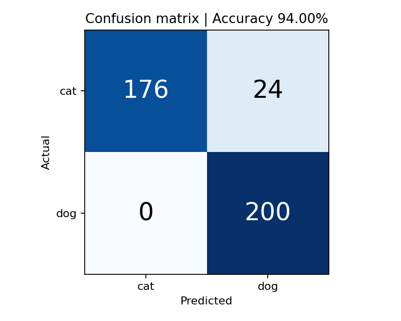

# Understanding Cat and Dog Predictions Using Grad-CAM

IEEE VIT Round 2 Machine Learning project using Python, PyTorch and pretrained ResNet-18. It classifies images from the **specified Yash Dogra Kaggle dataset**, displays successes and failures, and explains predicted species scores with Grad-CAM. **No training or fine-tuning is performed.**

## Actual recorded result

A fixed seed-42 subset of 200 cats and 200 dogs produced **94.00% accuracy (376/400)** with `ResNet18_Weights.IMAGENET1K_V1` on CPU. There were 24 cats predicted as dogs and zero dogs predicted as cats. These are sample results, not an official benchmark or guaranteed future accuracy.

| Actual / predicted | Cat | Dog |
|---|---:|---:|
| Cat | 176 | 24 |
| Dog | 0 | 200 |



## Run in Google Colab

1. Download `Cats_Dogs_GradCAM.ipynb`.
2. Open https://colab.research.google.com/ and use **File → Upload notebook**.
3. Optionally select **Runtime → Change runtime type → T4 GPU**. CPU works too.
4. Select **Runtime → Run all**. The first download is approximately 756 MiB plus model weights.
5. If Kaggle requests login, run `kagglehub.login()` separately and authenticate. Never commit credentials.
6. Inspect sections 8–10. The notebook displays predictions, metrics, correct/incorrect galleries and six Grad-CAM comparisons.
7. Download the results ZIP from the last cell. Save the executed notebook with **File → Download → Download .ipynb**.

`Executed_Local_Run.ipynb` is a separate, honestly labeled execution record produced on the build environment CPU using the predownloaded dataset. Its data path is local. Use the portable notebook above in Colab.

## Dataset and labels

Source: https://www.kaggle.com/datasets/yashdogra/cats-and-dogs, version 1.

The downloaded archive has **7,390 JPEGs** in `images/`: 2,400 cats and 4,990 dogs, plus three non-JPEG files. Filenames are breed-based, e.g. `Abyssinian_1.jpg` and `american_bulldog_1.jpg`. The 37 breeds correspond to Oxford-IIIT Pet, not the commonly assumed `PetImages/Cat` directory layout. An explicit mapping of 12 cat breeds and 25 dog breeds supplies ground truth. Unknown image filenames are counted and ignored. Non-image files are ignored. No selected images were skipped in the recorded run.

Before prediction, the script samples 200 valid, unique images per species with seed 42. It checks decoded pixel hashes to remove duplicates encountered while sampling. `predictions.csv` contains the exact selection and hashes. This is not an exhaustive corruption audit of all files or the official Oxford test split. Labels never come from the model.

## Method

1. Load each image with Pillow; apply EXIF orientation and convert to RGB.
2. Use the pretrained weight's official transform: resize shorter edge to 256, center crop 224 × 224, scale pixels to [0,1], and ImageNet normalization.
3. Load ResNet-18, set `eval()`, and freeze its weights.
4. Combine ImageNet domestic-cat categories (281–285) and domestic-dog categories (151–268). Exclude wild cats and canids. The metadata assertions and `outputs/class_mapping.json` document this mapping.
5. For each group, calculate `logsumexp` of its logits. Softmax over the two scores is equivalent to summing ImageNet probabilities within each group and conditioning on cat OR dog.
6. Select the higher species score. Record both conditional scores, original cat/dog probability mass, and ImageNet top-1 category.
7. Compare with ground truth to calculate metrics and create both galleries.
8. Explain the predicted grouped score using Grad-CAM at `model.layer4[-1]`.

The conditional scores are **not calibrated confidence**. A forced binary choice can be misleading if little of the original 1,000-class probability mass belongs to cats/dogs. The dog group contains many more categories than the cat group, which can bias this baseline.

## Grad-CAM explained

The last residual block produces spatial feature maps. We differentiate the **predicted species' grouped logit** with respect to these maps. Spatially averaged gradients weight the maps; a weighted sum followed by ReLU retains positive contributions. The map is resized to the model input size and normalized independently to [0,1]. Zero maps are explicitly flagged.

A figure includes the full original, the exact input crop, Grad-CAM, and the overlay. Overlay alignment uses the crop, avoiding a misleading stretch onto the full image. Gradients are enabled for explanations; no weights are updated. Heatmaps are coarse evidence visualizations, not pixel segmentation or proof of the reason for a prediction.


## Observations from the recorded run

- Correct Sphynx and Birman examples show stronger activation around the head/face.
- Correct Japanese Chin and Samoyed examples also emphasize the head, with broader activation around it.
- The incorrect `Sphynx_104.jpg` example is predicted dog even though the heatmap covers the cat's head and upper body. Locating the animal does not guarantee recognizing the species.
- All 24 errors in this sample are cats predicted as dogs. This warrants further evaluation of group-size imbalance and breed coverage; the heatmaps alone do not establish a cause.
- Independent map normalization means a red patch in two images does not imply equal absolute importance or confidence.

## Files

- `Cats_Dogs_GradCAM.ipynb`: portable, explained Colab workflow.
- `Executed_Local_Run.ipynb`: actual local execution record with outputs.
- `project.py`: reusable functions and command-line version.
- `test_project.py`: label, aggregation, and Grad-CAM invariants.
- `requirements.txt`: dependencies; Colab keeps its compatible Torch/Torchvision pair.
- `outputs/`: actual PNGs, predictions CSV, metrics, mapping and example manifest.
- `Project_Report.docx`: illustrated report ready to open in Google Docs.
- `SUBMISSION_GUIDE.md`: publishing steps.
- `INTERVIEW_PREP.md`: beginner-friendly explanation and questions.

## Run locally

Install a compatible PyTorch/Torchvision pair for your machine using https://pytorch.org/get-started/locally/, then:

```bash
pip install -r requirements.txt
python -c "import kagglehub; print(kagglehub.dataset_download('yashdogra/cats-and-dogs/versions/1'))"
python project.py --data /path/printed/above --out outputs --per-class 200 --seed 42
python -m unittest -v test_project.py
```

Python and exact framework versions from the recorded run are in `outputs/metrics.json`. The notebook uses standard APIs; floating-point differences across devices/versions may slightly affect scores. To change sample size, edit `PER_CLASS` or use `--per-class`. Report updated results honestly. If no mistakes occur, the error gallery says so; do not manufacture errors.

## Limitations and possible improvements

This is inference using ImageNet knowledge, with no fitted binary classifier. It assumes each image contains a cat or dog, uses a small sampled evaluation set, and does not audit overlap with pretraining data. Center cropping can remove useful content. The unequal ImageNet group sizes and limited domestic-cat categories can affect predictions. Grad-CAM is low resolution and not a causal explanation. Future work could compare additional pretrained ResNets, evaluate a larger fixed split, inspect breed-wise errors, or fine-tune a binary head **only if the task permits it**.

## References and image attribution

- Kaggle distribution by Yash Dogra: https://www.kaggle.com/datasets/yashdogra/cats-and-dogs
- Oxford-IIIT Pet, Parkhi et al., *Cats and Dogs* (2012): https://www.robots.ox.ac.uk/~vgg/data/pets/
- Torchvision ResNet-18: https://docs.pytorch.org/vision/stable/models/generated/torchvision.models.resnet18.html
- He et al., *Deep Residual Learning for Image Recognition*: https://arxiv.org/abs/1512.03385
- Selvaraju et al., *Grad-CAM*: https://arxiv.org/abs/1610.02391

Images in example figures are from the supplied Kaggle archive, whose breed naming matches Oxford-IIIT Pet. Credit remains with Oxford-IIIT Pet and original image owners. The Oxford source states CC BY-SA 4.0; derived example figures are shared under that attribution/share-alike basis. The full dataset and pretrained weights are not redistributed here. Kaggle's listing labels the distribution Apache 2.0; that is not treated as overriding original image rights.
